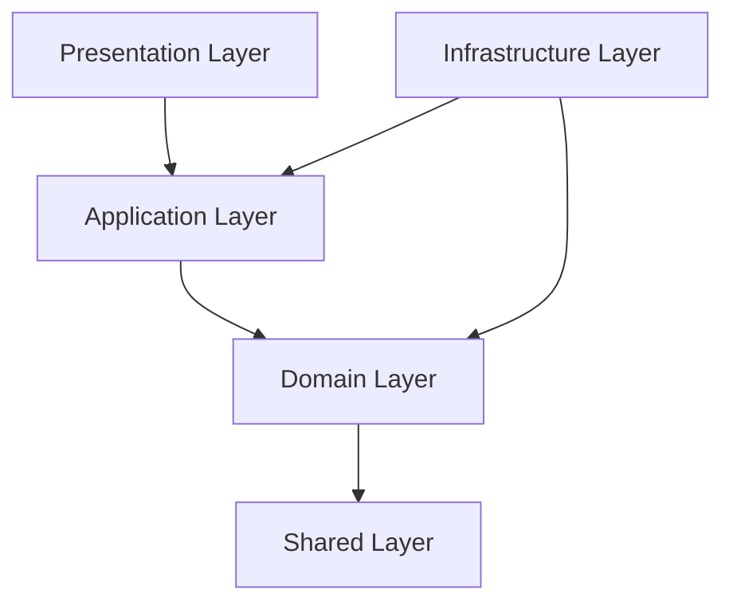

# Kỹ năng Clean Architecture cho NodeJS (clean-architecture-nodejs)

Kỹ năng này hướng dẫn việc tổ chức cấu trúc mã nguồn backend và định hướng luồng phụ thuộc dữ liệu nhằm duy trì tính linh hoạt, dễ kiểm thử và độc lập công nghệ của hệ thống.

---

## 1. Mục tiêu kỹ năng
* Đảm bảo kiến trúc hệ thống tuân thủ mô hình Clean Architecture.
* Bảo vệ lõi nghiệp vụ (Domain) không bị ảnh hưởng bởi những thay đổi công nghệ bên ngoài (Database, API Framework, Thư viện gửi mail...).
* Tách biệt rõ ràng trách nhiệm của từng cấu phần phần mềm để dễ dàng viết Unit Test độc lập.

---

## 2. Cấu trúc thư mục Backend đề xuất

Mã nguồn backend nằm trong thư mục `src/` và được tổ chức như sau:

```txt
src/
├── domain/                  # Lõi nghiệp vụ cốt lõi (Không phụ thuộc bất kỳ thư viện ngoài nào)
│   ├── entities/            # Các thực thể nghiệp vụ (ví dụ: User, Booking, Computer...)
│   ├── value-objects/       # Các đối tượng giá trị không có định danh (ví dụ: Email, Password...)
│   ├── services/            # Domain Services giải quyết nghiệp vụ liên quan đến nhiều thực thể
│   └── repositories/        # Các định nghĩa interface của Repository (cổng giao tiếp dữ liệu)
│
├── application/             # Các luồng xử lý (Workflows) và logic ứng dụng cụ thể
│   ├── usecases/            # Mỗi UseCase đảm nhận duy nhất một chức năng nghiệp vụ (ví dụ: CreateBookingUseCase)
│   ├── dtos/                # Data Transfer Objects định nghĩa cấu trúc dữ liệu trao đổi giữa các tầng
│   └── services/            # Application Services (ví dụ: TokenService, EmailService interface)
│
├── infrastructure/          # Triển khai kỹ thuật cụ thể và tích hợp công nghệ
│   ├── database/            # Cấu hình SQL Server, các migrations và Repository Implementations
│   │   └── sqlserver/
│   │       ├── mappers/     # Chuyển đổi dữ liệu giữa SQL Table Row và Domain Entity
│   │       ├── models/      # ORM Models hoặc định nghĩa kiểu dữ liệu bảng
│   │       └── repositories/# Triển khai chi tiết các câu lệnh SQL để truy vấn database
│   ├── security/            # Cài đặt mã hóa mật khẩu, JWT Token
│   ├── services/            # Triển khai EmailService, Logger, FileStorage...
│   └── config/              # Quản lý các cấu hình môi trường (.env)
│
├── presentation/            # Giao diện giao tiếp ngoài (HTTP API, WebSocket...)
│   ├── http/
│   │   ├── controllers/     # Tiếp nhận HTTP request, validate dữ liệu đầu vào và gọi Usecase
│   │   ├── routes/          # Định nghĩa các endpoints API và gắn middleware
│   │   ├── middlewares/     # Middleware xác thực (Auth), phân quyền (Role), xử lý lỗi (ErrorHandler)
│   │   └── requests/        # Các schemas hoặc class validate đầu vào (ví dụ: DTO Validator)
│
├── shared/                  # Tiện ích dùng chung không phụ thuộc nghiệp vụ (ví dụ: Result, Guard...)
│
└── main.ts                  # Điểm khởi chạy ứng dụng (Bootstrap: khởi tạo DB, Express App...)
```

---

## 3. Quy tắc phụ thuộc (Dependency Rules)

Mối quan hệ phụ thuộc giữa các tầng phải tuân thủ nghiêm ngặt nguyên tắc từ ngoài vào trong:



* **Presentation → Application**: Controller chỉ được phép gọi đến Use Case của Application. Tuyệt đối không gọi trực tiếp xuống Database hoặc Repository Implementation.
* **Application → Domain**: Use Case điều phối luồng xử lý dựa trên các thực thể và quy định trong Domain.
* **Infrastructure → Application/Domain**: Infrastructure chịu trách nhiệm hiện thực hóa (implement) các Interfaces được định nghĩa ở tầng Domain/Application.
* **Domain không phụ thuộc tầng nào khác**: Domain hoàn toàn cô lập, không chứa các import liên quan đến Express, SQL Server, hay bất kỳ thư viện mạng/framework nào.

---

## 4. Trách nhiệm cụ thể của từng cấu phần

* **Domain (Entities, Value Objects)**: Chứa các quy tắc nghiệp vụ mang tính sống còn. Thực thể (Entity) có định danh (ID) và chứa các phương thức tự thay đổi trạng thái kèm theo validation logic bên trong (ví dụ: `Booking.approve()` kiểm tra xem booking có đủ điều kiện duyệt không trước khi đổi trạng thái).
* **Application (Use Cases)**: Điều phối toàn bộ quy trình của một tác vụ cụ thể. Use Case chịu trách nhiệm: lấy entity từ repository -> gọi các hàm xử lý nghiệp vụ của entity -> lưu lại trạng thái mới thông qua repository -> gửi email thông báo (nếu có).
* **Infrastructure**: Đảm nhận việc thực hiện chi tiết các công nghệ. Nơi viết các câu truy vấn SQL Server, xử lý kết nối, cấu hình lưu file, ghi log chi tiết.
* **Presentation (Controllers)**: Đóng vai trò là "cổng gác". Nó chuyển đổi JSON request từ client thành DTO, kiểm tra xem client có truyền thiếu dữ liệu không (sử dụng thư viện validate như Joi, Zod hoặc class-validator), gửi DTO vào Use Case, rồi nhận kết quả trả về dạng `Result` để xuất ra mã lỗi HTTP tương ứng (200, 201, 400, 403, 500...).

---

## 5. Checklist trước khi commit code

Trước khi tạo Pull Request hoặc hoàn tất công việc, hãy kiểm tra:
* [ ] Trong thư mục `src/domain/` hoàn toàn không có import nào liên quan tới thư viện ngoài (trừ các thư viện thuần xử lý chuỗi/ngày tháng nếu bắt buộc).
* [ ] Không có câu lệnh SQL hay ORM query nào viết trong `src/presentation/` hoặc `src/application/`.
* [ ] Các Use Case được đặt tên theo đúng động từ hành động (ví dụ: `CreateBookingUseCase`, `ApproveBookingUseCase`).
* [ ] Dữ liệu truyền vào Use Case bắt buộc phải thông qua DTO hoặc các kiểu dữ liệu nguyên bản (primitive types), không truyền đối tượng Express Request/Response vào Use Case.
* [ ] Mọi lỗi nghiệp vụ (Business Error) phải được xử lý có kiểm soát (ví dụ trả về đối tượng `Result.fail(error)`) thay vì quăng Exception vô tội vạ làm sập server.
